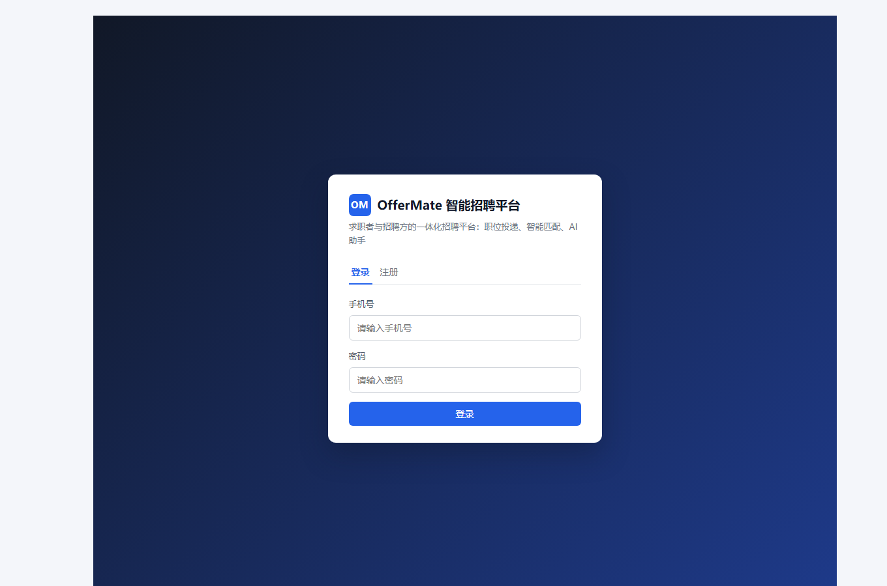
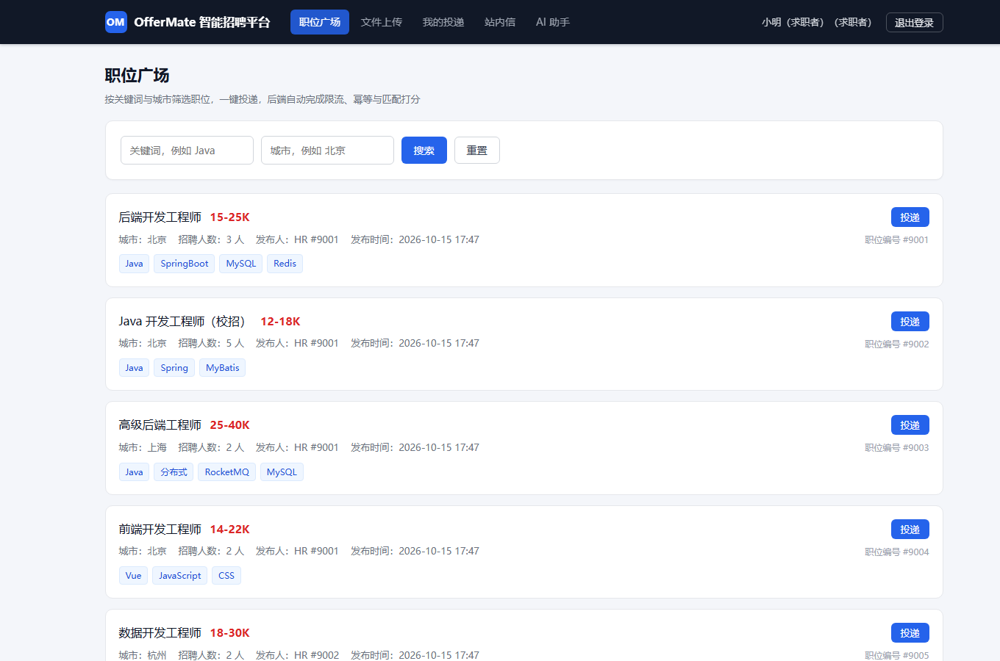
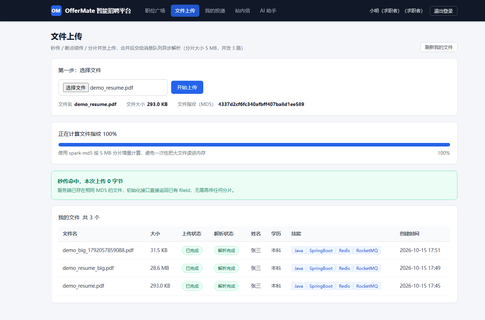
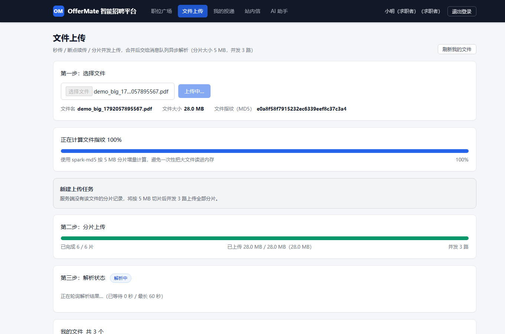
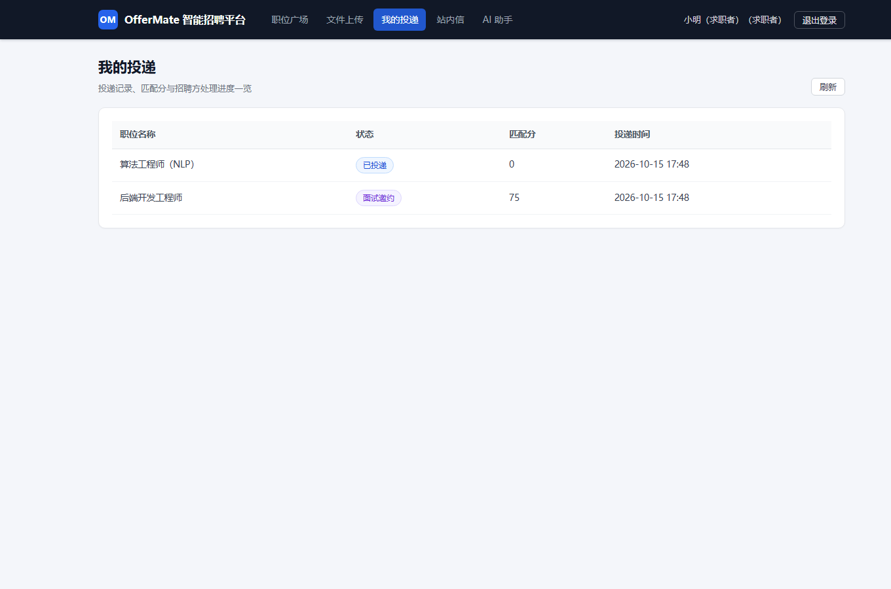
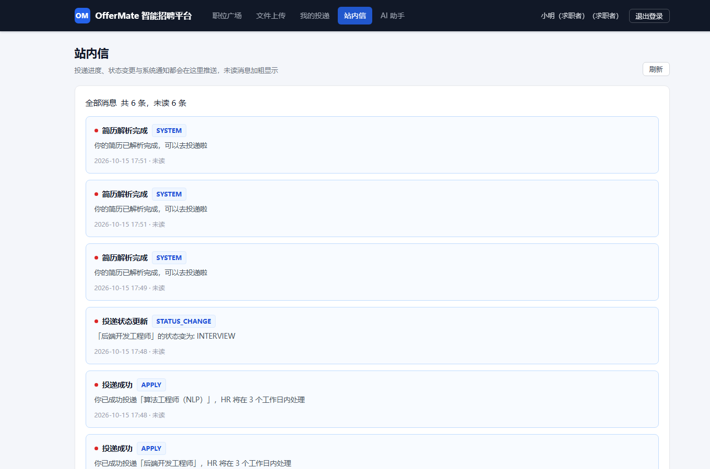
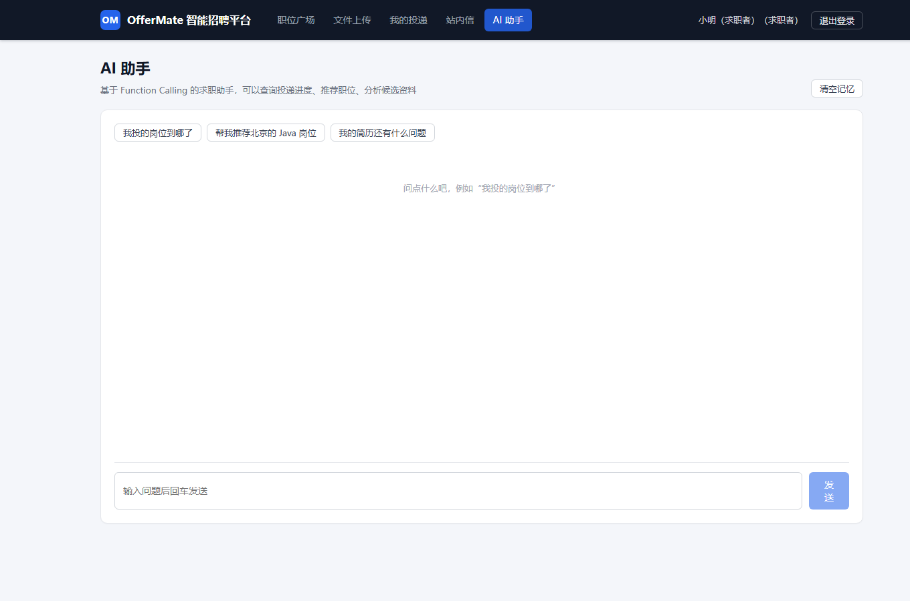
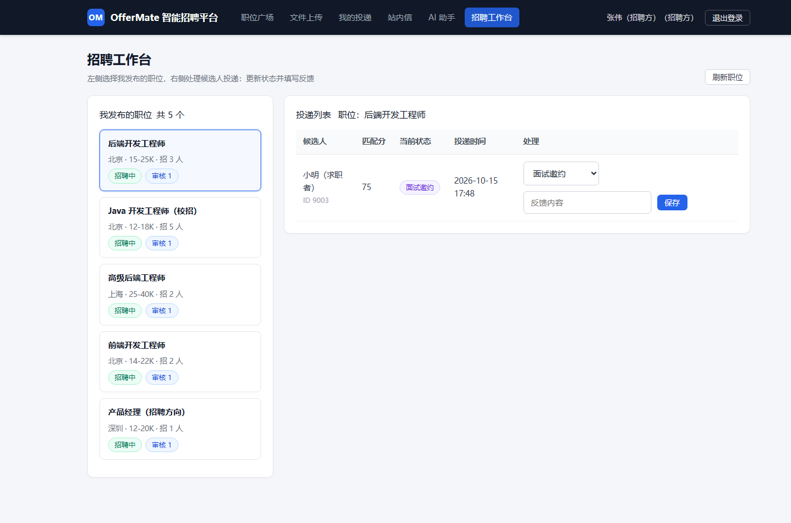
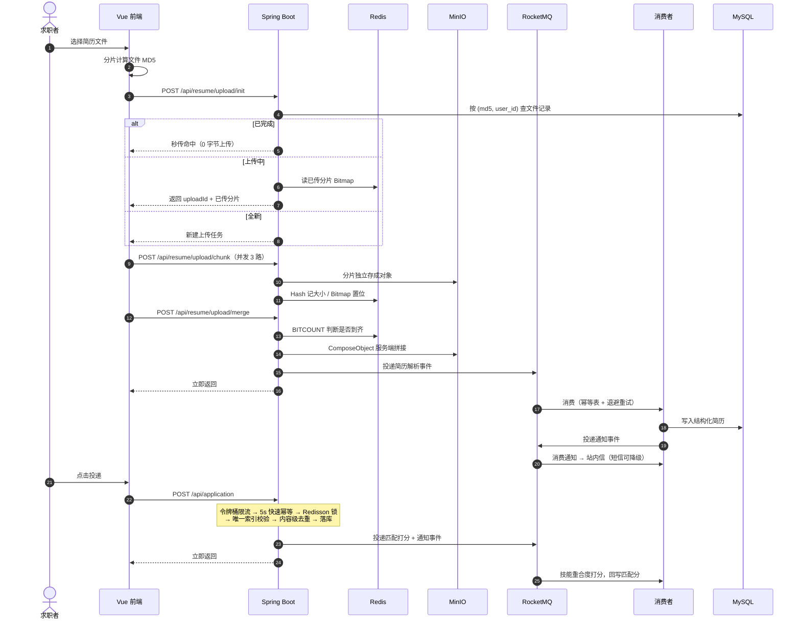

<div align="center">
  <h2>OfferMate</h2>

  <p>
    
    
    
    
    
    
    
    
    <a href="https://github.com/Logos-solipsism/offermate/actions/workflows/ci.yml"></a>
    <a href="./LICENSE"></a>
  </p>
</div>

<div align="center">

面向求职者与 HR 的<strong>双边招聘平台（智能招聘与人才库平台）</strong>。

覆盖 <strong>注册鉴权 → 简历分片上传与秒传 → 异步解析与结构化 → 职位投递（限流 / 幂等 / 去重）→ JD 匹配打分 → 状态流转与消息通知 → AI 求职助手</strong> 的完整业务闭环。

</div>

---

## 项目预览

**登录 / 注册**



**职位广场**：按关键词与城市检索在招职位，一键投递，后端自动完成限流、幂等与去重



**简历上传**：同一份文件再次上传命中秒传，一个字节都不用传



新文件走 5MB 分片 + 3 路并发上传，合并后由 MQ 异步解析



**我的投递**：状态与匹配分一目了然，匹配分由 MQ 消费者异步计算后回写



**站内信**：简历解析完成、投递成功、状态变更全部来自 MQ 消费者异步写入



**AI 求职助手**：Function Calling + Redis 会话记忆，可查投递进度、推荐岗位



**招聘方工作台**：查看候选人投递、流转状态并自动通知候选人



## 项目背景

招聘场景里堆着三个很硬的技术问题，这个项目就是围绕它们做的：

| 业务矛盾 | 典型现象 | 本项目的解法 |
| --- | --- | --- |
| **大文件传输不稳定** | 简历附件几十上百 MB，弱网下传一半断掉就得从头再来，用户直接流失 | 分片上传 + 断点续传 + 内容级秒传 |
| **长耗时任务阻塞主链路** | 简历解析、大模型结构化、JD 匹配是秒级到几十秒级操作，同步做会让接口卡住、线程池被拖垮 | RocketMQ 全链路异步化 + 幂等消费 + 重试与死信 |
| **高并发下的资源与成本失控** | 重复投递、脚本刷接口、同一份简历反复上传重复烧钱解析 | 令牌桶限流 + 内容级去重 + 分布式锁 |

## 核心功能

### 📦 可靠的大文件上传链路

> 弱网、中断、刷新页面都不该让用户从头再传一遍。

- **分片上传 + 断点续传** — 前端按 5MB 切片并发上传，Redis 用 **Hash 记分片大小、Bitmap 记哪片已到**，合并前用 BITCOUNT 判断是否到齐；中断后重新 init 会返回已传分片列表，**只补缺的那几片**。
- **内容级秒传** — 前端分片计算整个文件的 MD5，服务端以 `(md5, user_id)` 唯一索引为依据：命中即**一个字节都不用传**；跨用户命中时**复用存储对象但新建归属记录**，绝不返回别人的文件。
- **服务端合并** — 用 MinIO ComposeObject 在服务端把分片拼成完整对象，**数据不经过应用服务器**；合并失败保留分片、状态退回可重试，只有"切片大小非法"这种不可恢复错误才作废任务。

### ⚡ 全链路异步化

> 用户请求只做"确定能立刻做完的事"，慢的、会抖的、会失败的全部推给消息队列。

- **主链路只做六件事** — 参数校验、限流、快速幂等、分布式锁、去重落库、发消息，**不等待任何外部调用**（对照组接口 `/api/bench/apply-sync` 与 `apply-async` 实测单请求 841ms → 21ms；该对照刻意剥离了限流、幂等键与分布式锁，真实投递链路的口径见下方实测数据表）。
- **三条异步链路** — 简历解析（10~60 秒级）、JD 匹配打分（秒级）、站内信/短信推送（三方易抖动）各自独立消费，互不阻塞。
- **可靠性** — `mq_consume_log` 幂等表拦截重复消费；业务内指数退避重试接住网络抖动；超限消息进死信队列 `%DLQ%cg_resume_parse`，后台可按业务 ID 重放。

### 🛡️ 并发与成本护栏

> 限流和重试都是保护手段，不能自己变成新的故障点。

- **Redis + Lua 令牌桶** — 注解 + AOP 切面按「用户 / IP / 接口」三个维度限流，**阈值优先取配置表（运营改完 30 秒内生效，注解上的值只是兜底默认值）**；Lua 保证"补充令牌 → 判断 → 扣减 → 回写"原子执行，避免并发下双双放行；**Redis 不可用时降级为本机令牌桶**。
- **指数退避 + 抖动** — 失败不立刻重试（对方可能正在故障），间隔按 0.2s → 0.4s → 0.8s 递增并加随机抖动防重试风暴；长任务重试走 MQ 延时消息，**不占用业务线程**。
- **Redisson + WatchDog** — 合并与投递两处临界区加锁；看门狗自动续期，避免业务超时导致"锁提前释放 → 并发重复执行"；投递锁**在事务提交后才释放**。

### 🤖 AI 求职助手

> 让模型负责听懂话和组织语言，让代码负责查数据和鉴权。

- **Function Calling** — 把内部能力声明成工具：查投递进度、按城市/薪资/技能推荐岗位、查职位详情、简历诊断；**身份一律从服务端上下文取**，模型只能传筛选条件，无法越权查别人的数据。
- **只读 + 事实约束** — 工具不做任何写操作，返回的是数据库事实文本，系统提示要求"只能基于工具返回的数据回答，查不到就说查不到"。
- **Redis 会话记忆** — 多轮追问记忆落 Redis（窗口 20 条、7 天过期），服务重启与多实例都不"失忆"；每次对话按用户维度限流，因为每一轮都是真金白银的 Token。

## 系统流程



## 技术选型与取舍

| 选型 | 选择了 | 没有选择 | 原因 |
| --- | --- | --- | --- |
| 消息队列 | RocketMQ | Kafka | 需要**事务消息 + 延时消息 + 死信队列**，RocketMQ 原生支持，量级也不需要 Kafka 的吞吐 |
| 分布式锁 | Redisson | 手写 SETNX | 需要**可重入 + 看门狗续期 + 安全解锁**，手写容易在超时释放上踩坑 |
| 限流算法 | 令牌桶 | 固定窗口 / 漏桶 | 业务要"允许用户手滑连点、但不许脚本刷"：固定窗口有边界双倍漏洞，漏桶不允许任何突发 |
| 限流实现位置 | 应用层（注解 + AOP） | 网关 | 要按**业务身份**限流，网关拿不到解析后的用户身份 |
| 去重标识 | 文件内容 MD5 | 文件名 + 大小 | 改个文件名就能绕过；内容指纹才是"同一份简历"的真实判据 |
| 分片进度存储 | Redis（Hash + Bitmap） | MySQL | 写频繁、生命周期短（24h）、丢了最多重传几片；Bitmap 一位一片，5000 片只占 625 字节 |
| 对象存储 | MinIO | 本地磁盘 / 直接上云 OSS | 本地磁盘无法水平扩展；S3 兼容协议便于后续换成云存储 |
| 合并方式 | MinIO ComposeObject | 应用层流式拼接 | 服务端拼接**不占用应用内存与带宽**，大文件不会把 JVM 拖垮 |
| 鉴权 | JWT + Redis 会话 | 纯 JWT / 纯 Session | 纯 JWT 签发后无法撤销（踢不了人），纯 Session 依赖 Cookie 且多机要共享；折中方案既有自包含凭证又能服务端踢人 |
| 大模型接入 | LangChain4j | 手写 HTTP 调用 | 声明式定义 AI 服务与工具、自带会话记忆抽象，Function Calling 不用自己拼协议 |

## 快速开始

### 1. 启动中间件

```bash
# 一次把 MySQL(13306) / Redis(6379) / RocketMQ(9876) / MinIO(9000) 都拉起来
docker compose --profile minio up -d
```

> MinIO 定义在 `minio` profile 里（它的镜像比较大）。不加 `--profile minio` 服务也能启动，但简历上传会因为桶不存在而失败——启动时只在日志里打一条告警，不会中断启动。

### 2. 初始化数据库

```bash
mysql -h127.0.0.1 -P13306 -uroot -proot123456 < server/src/main/resources/db/schema.sql
mysql -h127.0.0.1 -P13306 -uroot -proot123456 < server/src/main/resources/db/data.sql   # 可选：演示数据
```

### 3. 配置大模型（可选）

不配置也能跑：AI 助手接口会降级返回提示语，其余功能不受影响。要真实体验就填一个 OpenAI 兼容服务的 Key（硅基流动 / DeepSeek / 通义 / 本地 Ollama 都可以）：

```bash
export AI_API_KEY=sk-你的key                     # Windows PowerShell: $env:AI_API_KEY="sk-你的key"
export AI_MODEL=Qwen/Qwen2.5-7B-Instruct
```

### 4. 启动后端

JWT 密钥没有内置默认值：不配置就直接启动失败（这是有意的，仓库里的默认密钥等于公开密钥）。先设一个 ≥32 字节的随机值，再启动：

```bash
export JWT_SECRET=$(openssl rand -base64 32)     # Windows PowerShell: $env:JWT_SECRET=[Convert]::ToBase64String((1..32 | %{Get-Random -Max 256}))
cd server && mvn spring-boot:run
```

接口文档：<http://localhost:18080/doc.html>

### 5. 启动前端

```bash
cd web && npm install && npm run dev
```

前端开发端口是 **5273**（`vite.config.js` 里可改），并通过 Vite 代理把 `/api` 转发到 `http://localhost:18080`，所以前端代码里不需要写死后端地址。

### 6. 运行单元测试

```bash
cd server && mvn test
```

30 个用例，覆盖 JWT 签发与篡改/过期校验、密钥启动期校验、登录拦截器的会话比对与客户端 IP 解析、指数退避的次数上限与封顶、限流阈值的配置表优先与兜底、解析故障注入能力、以及 HR 越权查询拦截；**不依赖 MySQL / Redis / RocketMQ**，所以 CI 里可以直接跑。

### 7. 或者：一条命令把中间件和后端都放进容器

```bash
docker compose --profile app --profile minio up -d --build
```

后端配置全部走环境变量（`application.yml` 里除 `JWT_SECRET` 外每一项都有本地默认值；密钥没有默认值——容器里也要把它传进去，否则启动即失败），容器之间用服务名互联，所以同一个 jar 既能本机跑也能进容器跑。前端仍在宿主机上用 Vite 开发服务器启动。

打开 <http://localhost:5273>。

### 演示账号（执行了 data.sql 之后可用）

| 角色 | 手机号 | 密码 | 能做什么 |
| --- | --- | --- | --- |
| 求职者 | 13911110001 | 123456 | 上传简历（分片/秒传/续传）、投递、看投递进度、AI 助手问答 |
| 招聘方 | 13811110001 | 123456 | 看自己发布的职位、查看投递列表、流转状态并通知候选人 |

## 实测数据

所有数字都是在本机真实压测出来的，方法和复现步骤见 **[bench/压测说明.md](bench/压测说明.md)**；原始采集输出未随仓库发布，表内数字以该文档记录的轮次与参数为准。

| 指标 | 改造前 | 改造后 |
| --- | --- | --- |
| 投递主链路对照实验（`/api/bench/apply-sync` / `apply-async`） | 841 ms（同步解析+打分+通知，其中解析为 Mock 固定 800 ms（`MOCK_PARSER_LATENCY_MILLIS`）） | **21 ms**（只做校验、落库、发消息；对照组不含限流、幂等键与分布式锁） |
| 50 并发吞吐 | 50 req/s | **275 req/s** |
| 50 并发 P99 | 1284 ms | **596 ms** |
| 注入 30% 三方故障时的最终成功率 | 68.0%（单次调用） | **99.50%**（指数退避重试后，200 次实测） |
| 同一账号对同一职位连续提交 6 次 | 6 条投递记录 | **只落 1 条**（拦截率 100%：1 次成功、4 次"请勿重复提交"、1 次"你已经投递过该职位"） |
| 投递接口突发 10 次请求 | 全部放行 | **只放行 5 次 + 5 次 429**（桶容量 5 / 每秒补 1）；按正常节奏（每 1.2 秒 1 次）连续请求全部通过 |
| 同一份简历重复上传 10 次 | 10 次上传 + 10 次解析 | **9 次秒传命中 + 只解析 1 次**（首次上传必然走完整链路，秒传从第 2 次开始） |
| 25MB 文件传 3/5 片后中断 | 需重传 5 片 | **只补传 2 片**，合并结果与源文件一致 |

## 目录结构

    offermate/
    ├─ docker-compose.yml            # 一键起 MySQL / Redis / RocketMQ / MinIO（app profile 还能起后端）
    ├─ .github/workflows/ci.yml      # CI：JDK 17 下编译并运行单元测试
    ├─ deploy/broker.conf            # RocketMQ broker 配置（Docker 场景需指定 brokerIP1）
    ├─ docs/
    │  ├─ 01-项目方案-OfferMate.md    # 架构、领域模型、亮点实现、DDL、接口、设计决策记录
    │  └─ 03-代码地图与已实现清单.md   # 每个文件干什么、已实现 / 待补齐
    ├─ bench/
    │  ├─ Bench.java                 # 纯 JDK 压测客户端（无第三方依赖，含故障注入实验接口）
    │  └─ 压测说明.md                 # 压测环境、方法、结果与复现步骤
    ├─ server/                       # Spring Boot 后端
    │  ├─ Dockerfile                # 多阶段构建：Maven 编译 + JRE 运行
    │  ├─ src/test/                 # 单元测试（不依赖中间件）
    │  └─ src/main/
    │     ├─ java/com/offermate/
    │     │  ├─ common/              # 鉴权、上下文、限流、重试、traceId、统一响应
    │     │  ├─ mq/                  # Topic 定义、生产者、幂等表、三个消费者、死信监听
    │     │  ├─ ai/                  # Function Calling 工具集、AI 服务、Redis 会话记忆
    │     │  └─ modules/             # auth / resume / job / application / notification
    │     └─ resources/
    │        ├─ application.yml      # 全部配置项支持环境变量覆盖
    │        ├─ lua/token_bucket.lua # 令牌桶 Lua 脚本（原子执行）
    │        └─ db/schema.sql, data.sql
    └─ web/                          # Vue 3 前端（登录、上传、职位、投递、站内信、AI 助手、HR 工作台）

## 已知边界

写在这里是因为这些都是我在实现过程中就知道、并且明确没有做的事：

- **解析能力抽成了接口（`ResumeParserClient`），压测与演示用的是可注入故障的实现**：压测要打几千次，真实调用大模型既烧钱、耗时又波动，无法作为稳定对照组——"故障注入 30%"那组数据就是靠它复现的。接入真实解析服务只需替换实现，业务代码不用改。AI 助手（Function Calling + Redis 记忆）这条链路是真实的调用代码。
- **匹配分是规则算法**（职位要求技能与简历结构化字段的重合度），不是模型打分。
- **发消息已在业务事务提交之后发送（afterCommit），但仍没有本地消息表**：原先在事务里发，消费者可能比提交更快、读不到刚插入的投递记录就把消息当成功丢掉（匹配分永远停在 0），11 月已改为提交后发送；剩下的窗口是"提交成功但发送失败"，此时只记一条 error 日志、只能人工重放——补上本地消息表 + 定时补偿才是完整解法，这是下一版第一件要补的事。
- **没有接入监控与告警**：目前用 traceId 串日志排查，没有接 Prometheus / SkyWalking。
- **MinIO 与 Redis 都是单节点**：没有副本、没有高可用，生产环境需要换成集群方案。
- **跨用户秒传没有引用计数**：两个用户共用同一个存储对象，一方删除会影响到另一方。
- **简历解析跑在业务服务里**：量大了应该拆成独立服务，避免慢调用拖累主服务。
- **压测环境是本机 Docker**：数字只能说明趋势，不代表线上表现。

## 文档

| 文档 | 内容 |
| --- | --- |
| [docs/01-项目方案-OfferMate.md](docs/01-项目方案-OfferMate.md) | 完整的项目方案：业务域、架构、六个技术难点的实现思路、DDL、接口清单、设计决策记录 |
| [docs/03-代码地图与已实现清单.md](docs/03-代码地图与已实现清单.md) | 代码地图与实现状态清单 |
| [bench/压测说明.md](bench/压测说明.md) | 压测环境、方法、全部实测结果与复现方式 |

## License

[MIT](LICENSE)

## 更新记录

- 2026-11-02 · 校准实测数据表：投递对照实验标注不含限流/幂等/锁；秒传命中口径修正；删除孤证数字